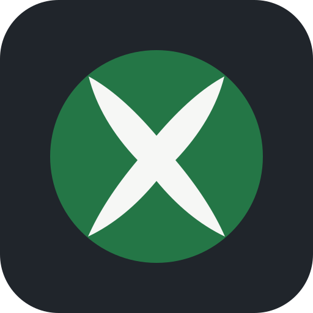
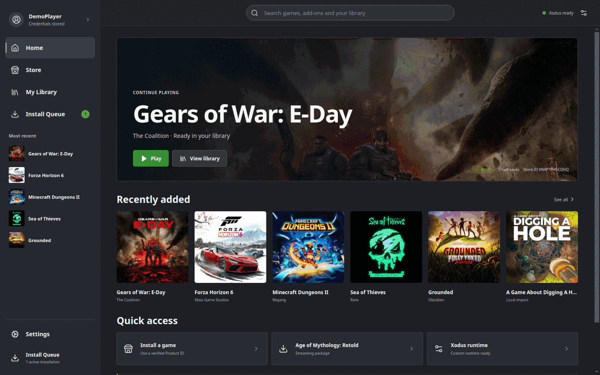

# Xodus Nexus

Your Microsoft Store PC games, on Linux.

An Xbox-inspired launcher built on [Xodus](https://github.com/xodus-gaming/xodus).
Browse the Store, install games you own or can access through a subscription,
and play with one shared runtime. Xbox sign-in and cloud saves are available
for supported games.

*Demo UI with a sample library and queue; screenshots are not compatibility claims.*

## Get started

[Downloads](https://github.com/domsvoboda/xodus-nexus/releases) ·
[Setup & documentation](https://github.com/domsvoboda/xodus-nexus/wiki) ·
[Report an issue](https://github.com/domsvoboda/xodus-nexus/issues)

## Compatible games

| Game | Tested features |
| --- | --- |
| Gears of War: E-Day | Launch, account sign-in, existing saves, online lobby |

[Full compatibility list](https://github.com/domsvoboda/xodus-nexus/wiki/Compatibility)

## Screenshots

[Library](docs/screenshots/demo-library.png) ·
[Store](docs/screenshots/demo-store.png) ·
[Install queue](docs/screenshots/demo-downloads.png) ·
[Settings](docs/screenshots/demo-settings.png)

Independent project, not affiliated with Microsoft or Xbox. A valid game license
is required. [MIT license](LICENSE) · [Contributing](CONTRIBUTING.md)
